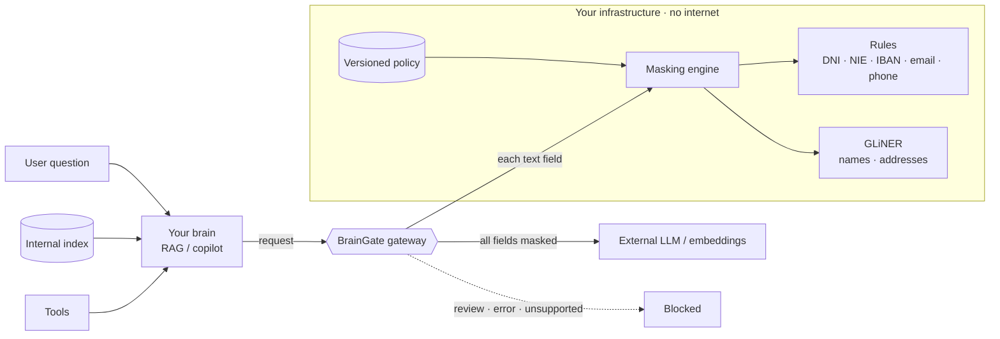

<div align="center">

# 🧠🛡️ BrainGate

**Local PII shield for AI assistants. Sensitive data never leaves your server unmasked.**

[](https://github.com/rvst312/brain-gate/actions/workflows/ci.yml)
[](LICENSE)


[Español](README.es.md) · [Architecture](docs/architecture.md) · [Policies](docs/policies.md) · [API](docs/api.md) · [Integration](docs/integration.md)

</div>

---

Your company "brain" (RAG assistant, internal copilot, knowledge base) is full of names, ID numbers,
IBANs, emails and addresses. Every time it calls an external LLM or embeddings API, that data goes with it.

**BrainGate sits between your brain and the outside world.** It detects personal data with local rules and
a local NER model, masks it according to a versioned policy, and only lets a request out when every field
has been processed. If anything is doubtful, broken or unsupported, the request is **blocked**, not sent.

```text
"María López pidió que le escribieran a maria@example.com"
                              │
                         BrainGate (local)
                              ▼
"[PERSONA] pidió que le escribieran a [EMAIL]"   ──►  external LLM
```

## Why BrainGate

- **🔒 100% local inference.** Model weights load from disk with network disabled. Nothing is sent anywhere to detect PII.
- **🇪🇸 Built for Spanish documents.** Validated detectors for DNI, NIE, IBAN (checksums), Spanish phones and emails, plus [GLiNER Multi PII](https://huggingface.co/urchade/gliner_multi_pii-v1) for names and addresses.
- **🚧 Fail-closed gateway.** Masks system prompt, history, retrieved context, tool calls and tool results while keeping the request structure. Review pending, detector down, timeout, attachment, unknown field → blocked.
- **🔁 Data reconstruction.** Optionally send unique keyed tokens (`[DNI_3b1e2db644]`) instead of fixed placeholders and get the provider's answer back with the real values. The lookup table lives in memory for one request.
- **📜 Versioned policies.** Categories, placeholders, thresholds, exceptions, overlap priority and doubt handling are config, not code. Every result records `policy_version` and `detector_version`.
- **🙊 No content in logs.** Telemetry is a whitelist of latencies, sizes, counts and versions. Error responses never echo the input.
- **🧩 Three ways to use it.** Python library, private HTTP API (`POST /v1/mask`) or CLI.

## Quickstart

```bash
git clone https://github.com/rvst312/brain-gate && cd brain-gate
uv sync --extra gliner --extra server      # rules work without extras; GLiNER needs them
uv run braingate download-model            # ~1.16 GB, pinned revisions (the only network step)
```

```bash
echo "Firmado: José Ángel Núñez García, DNI 12345678Z, Calle Mayor 12, 3º B, Madrid" | uv run braingate mask
# Firmado: [PERSONA], DNI [DNI], [DIRECCION]
```

No model yet? `uv run braingate mask --gliner none "..."` runs rules only (IDs, IBAN, email, phone).

> **macOS note:** if `uv run braingate` says `No module named 'brain_gate'`, Python is skipping the editable
> install's `.pth` file because macOS flagged it hidden. Fix: `chflags nohidden .venv/lib/python3.12/site-packages/*.pth`
> or prefix commands with `PYTHONPATH=src`. On Apple Silicon use an arm64 Python (torch has no macOS x86_64 wheels).

## Use cases

Every example runs as is, with or without the model downloaded.

### 1. RAG assistant calling an external LLM → [`examples/01_rag_chat_egress.py`](examples/01_rag_chat_egress.py)

The brain retrieves documents, calls a tool and builds a chat request. BrainGate masks every field and
forwards only the clean version. What the provider actually receives:

```json
{
  "system": "...Contrato de arrendamiento firmado por [PERSONA] (DNI [DNI]), con domicilio en [DIRECCION].\n\nDomiciliación bancaria: IBAN [IBAN]. Contacto: [EMAIL], [TELEFONO].",
  "messages": [
    {"role": "user", "content": "¿Cuándo vence el contrato de [PERSONA] y qué cuenta tiene domiciliada?"},
    {"role": "assistant", "content": [{"type": "tool_use", "name": "buscar_expediente",
      "input": {"cliente": "[PERSONA]", "email": "[EMAIL]"}}]},
    {"role": "user", "content": [{"type": "tool_result",
      "content": "Expediente 2024/118. Vence el 30/06/2027. Gestor: [PERSONA]."}]}
  ]
}
```

Add an image attachment and the request is `blocked (unsupported_part)`: the provider is never called.

### 2. Building a masked search / RAG index → [`examples/02_index_masking.py`](examples/02_index_masking.py)

Mask documents **before** chunking and embedding. The index stores masked text, an opaque internal reference,
masked titles and the policy/detector versions. A document with a DNI whose check letter is wrong goes to a
review queue instead of the index.

```text
doc_e531707e3d47#0   Contrato [PERSONA]      Arrendataria: [PERSONA], DNI [DNI].
doc_6921602963b2#0   Reclamación [PERSONA]   [PERSONA] reclama la devolución de la fianza.
Buscar 'fianza'    -> ['doc_6921602963b2']
Buscar '12345678Z' -> []
```

### 3. Private HTTP service for any language → [`examples/03_http_service.sh`](examples/03_http_service.sh)

```bash
curl -s localhost:8088/v1/mask -H "Authorization: Bearer $TOKEN" -H 'content-type: application/json' \
  -d '{"text": "María López pidió que le escribieran a maria@example.com", "policy_id": "brain-external-es"}'
```
```json
{"status": "masked", "masked_text": "[PERSONA] pidió que le escribieran a [EMAIL]",
 "policy_version": "brain-external-es@3", "detector_version": "rules@1+gliner-pii@1"}
```

### 4. Getting the real data back in the answer → [`examples/04_reversible_chat.py`](examples/04_reversible_chat.py)

With a reversible policy each value leaves as a unique keyed token instead of a fixed placeholder. The model can
tell entities apart, and the gateway rebuilds the answer (text and tool-call arguments) from an in-memory table
that lives only for that request.

```text
sent to the provider    "…titular del DNI [DNI_3b1e2db644]. Contacto: [EMAIL_bb25739858] … IBAN [IBAN]."
provider answers        "Envío el recordatorio a [EMAIL_bb25739858] indicando el DNI [DNI_3b1e2db644]."
what your app receives  "Envío el recordatorio a maria.lopez@example.com indicando el DNI 12345678Z."
```

Reversibility is set per category in the policy; here `IBAN` stays irreversible. See
[reversible tokens](docs/policies.md#reversible-tokens).

## How it works



1. **Detect.** Rules with checksum validation run over the whole text. GLiNER runs over overlapping windows cut at sentence ends, so long documents work and full names come out as one span.
2. **Resolve.** Duplicate and window-split detections of the same category are merged. Cross-category overlaps are resolved by policy priority, and the winner grows to the union so no fragment leaks.
3. **Decide.** Each span gets an action from the policy: `mask`, `keep` (exceptions) or `review`. Low-confidence spans follow the category's `on_doubt` rule.
4. **Apply.** Placeholders (or reversible tokens) are substituted on the original text. Accents, emojis, line breaks and everything outside the spans stay untouched. Offsets are Unicode code points.

More detail: [docs/architecture.md](docs/architecture.md).

## Performance (Apple M5, CPU only, 4 threads)

| Text | p50 | p95 |
|---|---:|---:|
| 60 chars | 33 ms | 35 ms |
| 1.5k chars | 248 ms | 279 ms |
| 10k chars | 1.5 s | 1.65 s |
| 25k chars (policy max) | ~3.5–4.9 s | — |

Peak memory ~2.4 GB. Rules-only mode is sub-millisecond. Measure on your own target server before
choosing `max_chars` and `BRAIN_GATE_TIMEOUT_S`.

## Tests

```bash
uv run pytest                  # 60+ tests: rules, engine, API, gateway, CLI, examples
uv run pytest -m "not slow"    # skip the end-to-end example runs
```

Real-model tests (`tests/test_gliner_real.py`) run automatically when the weights are in `models/` and
assert that loading opens **no network connection**. Without weights they are skipped, which is how CI runs.

The suite covers the acceptance criteria of the design: Spanish entities, checksum validation, overlaps,
entities crossing window boundaries, text integrity (accents, emoji, CRLF), no-detection inputs, auth and policy
permissions, size limits, timeouts, detector failure, no PII in logs or errors, and a mock provider proving that
history, documents and tool payloads are masked and that every failure mode blocks the call.

## Known limitations

- **Text only.** Images, documents and attachments are blocked on protected routes by design.
- **Over-masking.** Policy `brain-external-es@3` masks doubtful names and addresses instead of blocking. GLiNER sometimes tags role nouns or boilerplate at the start of a sentence ("El arrendatario", "El presente documento") as `PERSONA`. Safe, but it removes some context.
- **Not a compliance certificate.** BrainGate applies the policy you define. Whether that policy is adequate for your data (GDPR, sector rules) is for whoever owns and approves the policy.
- **No streaming restore.** Reversible tokens are restored on complete responses only. If the model alters a token, it is left visible rather than guessed.
- **Masked search.** Searching by exact name or ID in a masked index won't match. Use a restricted local lookup on the originals with document permissions (see [architecture](docs/architecture.md#exact-identifier-lookup)).

## Roadmap

- [ ] Labeled Spanish corpus and per-category escape / false-positive metrics
- [ ] [OpenAI Privacy Filter](https://huggingface.co/openai/privacy-filter) as a second local detector for comparison
- [ ] Optional local decision model to re-score doubtful spans (mask / keep / review)
- [ ] Resumable batch re-indexing job
- [ ] Docker image

## Contributing

Issues and PRs are welcome: see [CONTRIBUTING.md](CONTRIBUTING.md). Report vulnerabilities privately as
described in [SECURITY.md](SECURITY.md).

## License

[Apache 2.0](LICENSE). The GLiNER Multi PII v1 weights are Apache 2.0 and the mDeBERTa-v3 tokenizer is MIT. Both are
downloaded separately and are not redistributed in this repository.
